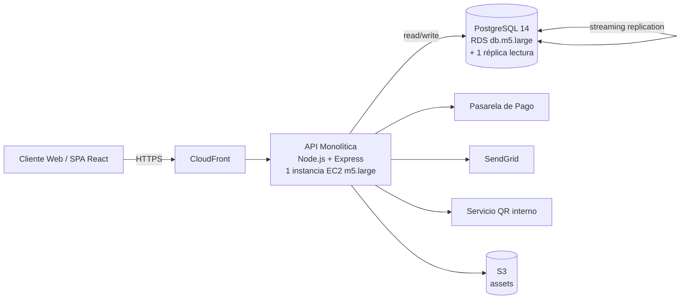
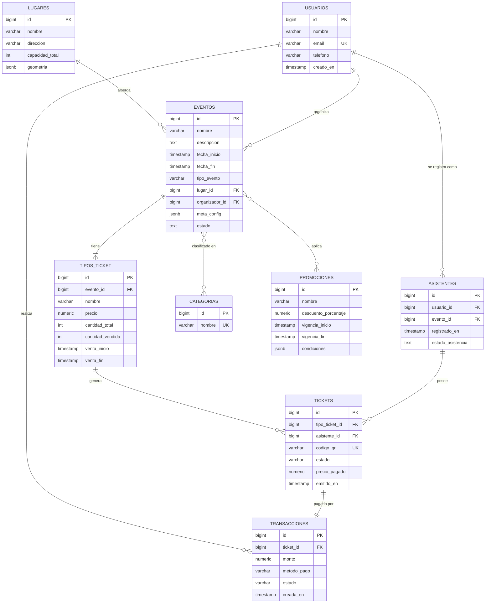

# 02 — Diagnóstico del enfoque tradicional

> **Ítem evaluado:** Diagnóstico del enfoque tradicional (arquitectura actual, modelo existente, cuellos de botella, limitaciones).

---

## 1. Arquitectura actual (AS-IS)

### 1.1 Vista de componentes

Eventix opera hoy bajo una **arquitectura monolítica de tres capas**, centralizada en una sola región cloud:

**Observaciones relevantes:**

- **Single point of failure (SPOF):** la API monolítica corre en una sola instancia EC2 (sin auto-scaling configurado aún).
- **DB con rol mixto:** sirve simultáneamente a transacciones de venta y a reportes analíticos.
- **Sin cache:** no hay capa Redis/Memcached; cada request golpea la base.
- **Sin bus de eventos ni processing asíncrono:** los QR se generan dentro del request de compra (bloqueando latencia).

### 1.2 Inventario técnico

| Capa           | Tecnología                                | Notas                                                       |
| -------------- | ----------------------------------------- | ----------------------------------------------------------- |
| Frontend       | React 18, SSR parcial con Next.js (legado)| Bundling propio, sin CDN dedicado de assets.                |
| Backend        | Node.js 18, Express 4                     | Monolito, ~80 endpoints.                                    |
| ORM            | Sequelize 6                               | Migrations versionadas con `sequelize-cli`.                 |
| Persistencia   | PostgreSQL 14 (RDS)                       | `db.m5.large`, 100 GB gp3, backups diarios.                |
| Auth           | JWT firmado (HS256) en cookies httpOnly   | Sin refresh tokens rotativos.                               |
| Cache          | _(inexistente)_                           | Cuello de botella recurrente.                               |
| Async jobs     | BullMQ + Redis (sólo emails)              | Infra subutilizada.                                         |
| Observabilidad | CloudWatch básico + logs en stdout        | Sin tracing distribuido.                                    |

---

## 2. Modelo de datos relacional actual

### 2.1 Diagrama entidad-relación (3FN)

### 2.2 Estimación de cardinalidad (a 2023)

| Tabla           | Filas aprox. | Tasa de crecimiento mensual |
| --------------- | ------------ | -------------------------- |
| `usuarios`      | 180.000      | +3%                        |
| `eventos`       | 340 / año    | +2%                        |
| `tipos_ticket`  | 3 / evento   | ≈ constante                |
| `tickets`       | 520.000      | +5%                        |
| `transacciones` | 520.000      | +5%                        |
| `asistentes`    | 520.000      | +5%                        |
| `promociones`   | 1.200 / año  | ≈ constante                |

### 2.3 Decisiones de modelado relevantes

- **3FN estricta.** Cada atributo vive en su tabla; no hay redundancia controlada.
- **Atributos dinámicos** del evento (configuración de encuesta, layout, branding, parámetros de streaming para híbridos) van a una columna `meta_config JSONB` — **opaca para consultas SQL nativas**.
- **Snapshot implícito**: el ticket guarda `precio_pagado` (denormalizado) para preservar el precio histórico aunque el `tipos_ticket.precio` cambie.
- **Inventario** se calcula mediante `cantidad_vendida` en `tipos_ticket` (campo desnormalizado, **sin constraint transaccional explícito** que evite sobreventa en condiciones de carrera).

> ⚠️ **Nota crítica:** el control de inventario es **lógica de aplicación** (transacción + verificación previa + `UPDATE … WHERE cantidad_vendida < cantidad_total`). No hay `CHECK` ni `EXCLUDE` constraint a nivel DB para evitar la condición de carrera.

---

## 3. Cuellos de botella identificados

### 3.1 Cuellos de botella de rendimiento

| ID    | Cuello de botella                                                                                                  | Síntoma                                                          | Causa raíz                                                                 |
| ----- | ------------------------------------------------------------------------------------------------------------------ | ---------------------------------------------------------------- | -------------------------------------------------------------------------- |
| CB-1  | **Reporte "vista de evento"** une 5+ tablas                                                                     | p95 = 3–8 s, picos 18 s                                         | Falta de desnormalización + ausencia de índices compuestos                  |
| CB-2  | **Apertura de venta de evento masivo**                                                                          | Degradación del 60% al pasar de 800 a 1.200 TPS                  | Single primary RDS sin réplicas de lectura dedicadas a la cola de escritura |
| CB-3  | **Generación de QR bloqueante** dentro del request                                                              | +800 ms por ticket en el flujo de compra                         | Job sincrónico en el camino crítico                                         |
| CB-4  | **Búsqueda de eventos** con filtros (categoría + ciudad + rango de fechas)                                      | Sin índice funcional, hace `Seq Scan`                            | Índices multicolumna inexistentes o mal compuestos                          |
| CB-5  | **`meta_config JSONB`** no es consultable nativamente                                                            | Cada query de "configuración de branding" requiere parseo en app | Diseño: la base ignora el JSON porque no hay `GIN index`                   |

### 3.2 Cuellos de botella de flexibilidad

| ID    | Limitación                                                                                                        | Impacto                                                          |
| ----- | ----------------------------------------------------------------------------------------------------------------- | ---------------------------------------------------------------- |
| CB-6  | `ALTER TABLE` recurrente para agregar atributo a un tipo de evento                                                | 2–15 s de lock en producción; requiere ventana de mantenimiento   |
| CB-7  | Atributos distintos por "tipo_evento" forzados a caber todos en la misma tabla                                     | Muchas columnas NULL;CHECK `tipo_evento` que rompe la encapsulación |
| CB-8  | Cada tipo de evento nuevo exige migración + despliegue                                                            | TTM de feature 3–7 días                                          |

### 3.3 Cuellos de botella operativos

| ID    | Limitación                                                                                                        | Impacto                                                          |
| ----- | ----------------------------------------------------------------------------------------------------------------- | ---------------------------------------------------------------- |
| CB-9  | Réplica de lectura sub-utilizada (consultas de reporte no la usan porque la lógica está en el API monolith)        | Réplica infrautilizada; sobrecarga del primary                   |
| CB-10 | Sin estrategia de cache — cada `GET /eventos` golpea el primary                                                    | Carga innecesaria incluso para datos casi-estáticos              |
| CB-11 | Ausencia de tracing distribuido + métricas por endpoint                                                            | MTTR alto ante incidentes                                        |
| CB-12 | Backups full + PITR habilitado pero nunca probado en restore                                                        | Riesgo en DR                                                     |

---

## 4. Limitaciones transversales

### 4.1 Escalabilidad

| Aspecto                    | Estado actual                                                                 | Limitación                                                                |
| -------------------------- | ------------------------------------------------------------------------------ | ------------------------------------------------------------------------- |
| **Escalado vertical**      | Posible hasta `db.m5.4xlarge` (~16 vCPU, 64 GB)                                | Caro y finito; próximo techo en ~12–18 meses                              |
| **Escalado horizontal**    | No implementado (single primary + réplicas de lectura)                         | Las réplicas no absorben escritura; no hay sharding real                  |
| **Sharding manual**       | No contemplado                                                                 | Reescritura completa de la capa de acceso                                  |

### 4.2 Disponibilidad

- **RPO ~ 5 min** (replicación streaming + WAL).
- **RTO estimado ~ 30 min** (failover manual + warm standby).
- **Sin multi-región**: outage de `us-east-1` = caída total.
- **Failover del primary** requiere intervención manual hoy (no automatizado con RDS Multi-AZ correctamente configurado).

### 4.3 Consistencia e integridad

- ✔ ACID fuerte dentro de una sola transacción.
- ✔ `FK` constraints presentes.
- ✘ **Race condition** en inventario de `tipos_ticket` (CB-2): dos requests concurrentes pueden leer `cantidad_vendida = 99` y ambos vender el ticket 100.
- ✘ No hay optimistic locking por versión (`updated_at` existe pero no se chequea en updates).

### 4.4 Flexibilidad de esquema

- ✔ Soporta transacciones y reportes estructurados de forma correcta.
- ✘ Penaliza la evolución del modelo: cualquier cambio requiere migración coordinada.
- ✘ Datos naturalmente semi-estructurados (atributos de eventos, metadata de tickets, configuración de encuestas) terminan en blobs opacos.

### 4.5 Costos operativos (estimación mensual, región `us-east-1`)

| Recurso                       | Costo USD/mes (estimado) |
| ----------------------------- | ------------------------ |
| RDS db.m5.large Multi-AZ      | ~520                     |
| RDS réplica lectura           | ~260                     |
| EC2 API m5.large              | ~70                      |
| Almacenamiento gp3 (100 GB)   | ~12                      |
| CloudFront + transferencia    | ~80                      |
| Otros (logs, monitoreo, S3)   | ~60                      |
| **Total mes**                 | **~1.000 USD**           |

---

## 5. Casos de uso afectados

| Caso de uso                                  | Impacto del cuello de botella         | Latencia observada | Latencia objetivo |
| -------------------------------------------- | ------------------------------------- | ------------------ | ----------------- |
| **Búsqueda pública de eventos**             | Cache inexistente (CB-10)             | 600 ms             | < 200 ms          |
| **Compra de ticket (camino feliz)**          | QR bloqueante + race inventory (CB-2/3)| 1.500 ms           | < 500 ms          |
| **Dashboard "live" de evento**              | JOINs en reporte (CB-1)               | 5.000 ms           | < 2.000 ms        |
| **Cierre contable / cuadre diario**          | Reportes sobre primary (CB-9)         | 30–60 s            | < 10 s            |
| **Alta de evento corporativo**               | Migración + redeploy (CB-6/8)         | 2–5 días           | < 4 horas         |
| **Exportación de lista de asistentes**       | JOINs + serialización (CB-1)          | 8–14 s             | < 3 s             |

---

## 6. Resumen de hallazgos

El sistema **funciona** y mantiene integridad transaccional, pero **fricciona** en cuatro dimensiones:

1. **Flexibilidad de esquema** — bloquea la velocidad de evolución del producto.
2. **Rendimiento de lectura agregada** — penaliza la operación en tiempo real.
3. **Escalabilidad de escritura** — tiene un techo físico no muy lejano.
4. **Costo cognitivo** — cada cambio obliga a migraciones coordinadas y lectura cuidadosa de dependencias de FKs.

Estos hallazgos justifican explorar **una capa de persistencia complementaria o sustituta** que resuelva los puntos 1, 2 y 3 sin renunciar al punto 4 (consistencia transaccional cuando sea necesaria). El siguiente documento compara las alternativas tecnológicas disponibles.
