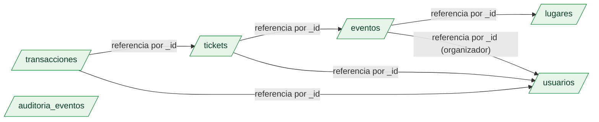

# 04 — Modelado de datos

> **Ítem evaluado:** Modelado de datos (esquemas, colecciones, documentos, relaciones, índices).

**Tecnología:** MongoDB 7.x (decisión justificada en el documento 03).

---

## 1. Principios de modelado

El modelado en MongoDB **no es "guardar JSON en una tabla"**. Optimizamos para los **patrones de acceso** del negocio, no para reducir duplicación.

### 1.1 Reglas embed vs reference

MongoDB ofrece dos estrategias y la elección es técnica, no estética.

| Regla                                                                    | Consecuencia                                                                       |
| ------------------------------------------------------------------------ | ---------------------------------------------------------------------------------- |
| **Embed** si la entidad subordinada **se lee siempre con el padre** y su cardinalidad es **baja/acotada** | Una sola lectura devuelve todo el agregado. Sin JOINs. Mayor duplicación, aceptable. |
| **Reference** si la cardinalidad es **alta o ilimitada**, o si la entidad **se consulta de forma independiente** | Mantiene el documento padre pequeño; requiere lookup. Más cercano al JOIN de SQL.  |
| **Embed + array acotado** para entidades tipo "configuración" que cambian con el padre | Ideal para tipos de ticket, promociones, métricas embebidas.                       |
| **Snapshot embed** cuando se necesita **inmutabilidad histórica** (ej. precio al momento de compra) | Se duplica el dato en el momento de la venta; nunca se actualiza al modificar el padre. |
| **Nunca embed** entidades con muchos cientos de documentos por padre o con queries independientes frecuentes | Ej. mensajes de un chat, transacciones de un usuario.                              |

### 1.2 Decisiones por entidad del dominio

| Entidad                  | Estrategia        | Justificación                                                                                  |
| ------------------------ | ----------------- | ---------------------------------------------------------------------------------------------- |
| `usuarios`               | colección propia  | Se consulta sola y por muchos caminos.                                                          |
| `lugares`                | colección propia  | Reutilizable entre eventos; consultas independientes (búsqueda por ciudad).                    |
| `eventos`                | colección propia con **embed** | Cardinalidad baja: tipos_ticket (≤10), categorías (≤5), promociones activas (≤5). Métricas embebidas. |
| `tickets`                | colección propia con **snapshot embed** | Cardinalidad alta (cientos de miles); necesita `embed` de datos del asistente + del tipo de ticket al momento de compra (inmutabilidad histórica). |
| `promociones`            | **embed** dentro de `eventos`     | Son efímeras, viven y mueren con el evento; no se reutilizan entre eventos.                    |
| `transacciones`          | colección propia  | Cardinalidad alta; queries de reporting independientes (cierre contable).                       |
| `auditoria_eventos`      | colección aparte  | Crecimiento append-only; escrituras masivas que no deben afectar a otras colecciones.          |

---

## 2. Diagrama del modelo (vista lógica)



> En negrita **embed**: `tipos_ticket`, `categorias`, `metricas_evento`, `configuracion_evento`, `promociones[]` viven dentro de cada documento de `eventos`.

---

## 3. Esquemas de las colecciones

> Los ejemplos siguientes son documentos **representativos**, no exhaustivos. Cada campo se documenta con su tipo BSON y su propósito.

### 3.1 `usuarios`

```json
{
  "_id": "ObjectId('66a8...1a')",
  "email": "ana.gomez@example.com",
  "email_normalizado": "anagomez@example.com",
  "nombre": "Ana Gómez",
  "telefono": "+57 311 555 1234",
  "documento_identidad": "1234567890",
  "tipo_usuario": ["asistente", "organizador"],
  "fecha_nacimiento": "1992-04-15",
  "preferencias": {
    "newsletter": true,
    "idioma": "es-CO",
    "canal_notif": ["email", "sms"]
  },
  "estadisticas": {
    "eventos_asistidos": 12,
    "tickets_comprados": 18,
    "ltv_cop": 2450000
  },
  "creado_en": "2024-02-12T14:00:00Z",
  "actualizado_en": "2024-09-01T09:30:00Z",
  "_v": 3
}
```

**Decisiones:**
- `email_normalizado` (lowercase, sin puntos) soporta búsquedas rápidas y unique index.
- `preferencias` y `estadisticas` embebidos: cardinalidad 1:1 con el usuario.
- `_v` para optimistic locking (evita lost updates en updates concurrentes).

### 3.2 `lugares`

```json
{
  "_id": "ObjectId('66b0...2b')",
  "nombre": "Corferias - Pabellón 4",
  "direccion": "Carrera 37 #24-67, Bogotá",
  "ciudad": "Bogotá",
  "pais": "CO",
  "capacidad_total": 2500,
  "geometria": {
    "type": "Point",
    "coordinates": [-74.090, 4.654]
  },
  "salas": [
    { "nombre": "Sala A", "capacidad": 1500, "piso": 1 },
    { "nombre": "Sala B", "capacidad": 800,  "piso": 1 },
    { "nombre": "Streaming", "capacidad": 5000, "tipo": "virtual" }
  ],
  "activo": true,
  "creado_en": "2023-08-01T10:00:00Z"
}
```

**Decisiones:**
- `salas` embebidas (≤10): se leen siempre junto al lugar.
- Índice geoespacial `2dsphere` sobre `geometria` para "eventos cerca de mí".

### 3.3 `eventos`

Es la colección **central** del modelo. Embebe sus entidades subordinadas para soportar el dashboard operativo con **una sola lectura**.

```json
{
  "_id": "ObjectId('66c1...3c')",
  "slug": "rock-al-parque-2025",
  "nombre": "Rock al Parque 2025",
  "tipo_evento": "masivo",
  "descripcion": "Festival de rock con 4 escenarios",
  "fecha_inicio": "2025-09-12T16:00:00Z",
  "fecha_fin": "2025-09-14T23:00:00Z",
  "estado": "publicado",
  "visibilidad": "publico",
  "organizador_id": "ObjectId('66a8...1a')",
  "lugar_id": "ObjectId('66b0...2b')",

  "categorias": ["musica", "rock", "festival"],

  "configuracion_evento": {
    "plantilla_id": "festival_v2",
    "branding": {
      "color_primario": "#FF6B35",
      "color_secundario": "#004E89",
      "logo_url": "https://cdn.eventix.test/brands/rock2025.png"
    },
    "encuesta_post_evento": {
      "habilitada": true,
      "preguntas": [
        { "id": "q1", "tipo": "escala", "texto": "¿Cómo calificarías el evento?", "rango": [1, 5] },
        { "id": "q2", "tipo": "abierta", "texto": "¿Qué artista disfrutaste más?" }
      ]
    },
    "hibrido": {
      "habilitado": true,
      "url_streaming": "https://stream.eventix.test/rock2025"
    }
  },

  "tipos_ticket": [
    {
      "_id": "ObjectId('66c2...01')",
      "nombre": "General Día 1",
      "precio_cop": 120000,
      "aforo_total": 8000,
      "aforo_vendido": 1234,
      "restricciones": {
        "edad_minima": 0,
        "max_por_compra": 6,
        "venta_inicio": "2025-06-01T00:00:00Z",
        "venta_fin": "2025-09-12T15:00:00Z"
      }
    },
    {
      "_id": "ObjectId('66c2...02')",
      "nombre": "VIP 3 días",
      "precio_cop": 850000,
      "aforo_total": 500,
      "aforo_vendido": 487,
      "restricciones": { "edad_minima": 18, "max_por_compra": 2 }
    }
  ],

  "promociones": [
    {
      "codigo": "EARLY2025",
      "tipo": "porcentaje",
      "valor": 25,
      "aplica_a_tipo_ticket_ids": ["ObjectId('66c2...01')"],
      "vigencia_inicio": "2025-01-01T00:00:00Z",
      "vigencia_fin": "2025-03-31T23:59:59Z",
      "usos_maximos": 1000,
      "usos_realizados": 234,
      "activo": false
    }
  ],

  "metricas_evento": {
    "tickets_vendidos_total": 1721,
    "ingresos_cop": 415000000,
    "ultima_actualizacion": "2025-09-01T12:00:00Z"
  },

  "tags": ["2025", "festival", "bogota"],

  "creado_en": "2024-11-20T10:00:00Z",
  "actualizado_en": "2025-09-01T12:00:00Z",
  "_v": 17
}
```

**Decisiones críticas:**

- **`tipos_ticket` embebido** ≤ 10 elementos: el dashboard "vista de evento" hace `findOne(_id)` y obtiene precios, aforos y ocupación sin un solo JOIN.
- **`promociones` embebido y acotado**: caduca con el evento; consultar `evento.promociones[].activo=true` es 1 lectura.
- **`configuracion_evento` reemplaza `meta_config JSONB` opaco**: ahora es consultable, indexable y validable.
- **Snapshot vs referencia en `metricas_evento`**: aquí es **deriva controlada** del primario, no snapshot histórico. Se acepta el riesgo de desfase (se actualiza en cada `compra_ticket`).

### 3.4 `tickets`

```json
{
  "_id": "ObjectId('66d1...01')",
  "codigo_qr": "QR-RK25-AB12CD34",
  "estado": "emitido",
  "evento_id": "ObjectId('66c1...3c')",
  "comprado_por_usuario_id": "ObjectId('66a8...1a')",

  "snapshot_tipo_ticket": {
    "tipo_ticket_id": "ObjectId('66c2...01')",
    "nombre": "General Día 1",
    "precio_cop": 120000
  },

  "asistente_snapshot": {
    "usuario_id": "ObjectId('66a8...1a')",
    "nombre": "Ana Gómez",
    "documento_identidad": "1234567890",
    "email": "ana.gomez@example.com"
  },

  "precio_pagado_cop": 90000,
  "promocion_aplicada_codigo": "EARLY2025",
  "transaccion_id": "ObjectId('66e1...01')",

  "emitido_en": "2025-02-15T11:24:00Z",
  "validado_en": null,
  "validado_por_puerta": null,
  "revalidaciones": [],

  "_v": 1
}
```

**Decisiones críticas:**

- **Snapshot del tipo_ticket y del asistente**: el ticket guarda **cómo era** el tipo de ticket al momento de venta. Aunque el `evento.tipos_ticket[_id].precio` cambie, este ticket conserva `precio_pagado_cop` histórico.
- **Cardinalidad alta**: tickets NO se embeben en `eventos` (rompería el límite de 16 MB por documento y degradaría consultas). Vive en colección aparte.
- **Traza de validación**: `validado_en` + `validado_por_puerta` permiten auditoría de acceso al evento.

### 3.5 `transacciones`

```json
{
  "_id": "ObjectId('66e1...01')",
  "usuario_id": "ObjectId('66a8...1a')",
  "ticket_id": "ObjectId('66d1...01')",
  "monto_cop": 90000,
  "moneda": "COP",
  "metodo_pago": "tarjeta_credito",
  "pasarela": "wompi_mock",
  "estado": "aprobada",
  "referencia_pasarela": "TXN-MOCK-987654",
  "creada_en": "2025-02-15T11:24:00Z",
  "confirmada_en": "2025-02-15T11:24:03Z"
}
```

> Cardinalidad alta, queries de reporting independientes (cuadre diario). Sin embebidos.

### 3.6 `auditoria_eventos`

```json
{
  "_id": "ObjectId('66f1...01')",
  "actor_id": "ObjectId('66a8...1a')",
  "actor_rol": "organizador",
  "accion": "ticket.emitido",
  "sujeto_tipo": "ticket",
  "sujeto_id": "ObjectId('66d1...01')",
  "metadata": {
    "evento_id": "ObjectId('66c1...3c')",
    "ip": "190.24.x.x",
    "user_agent": "Mozilla/5.0 ...",
    "monto_cop": 90000
  },
  "ocurrido_en": "2025-02-15T11:24:00Z"
}
```

> Append-only, separado del tráfico transaccional para no impactar el camino crítico.

---

## 4. Índices

Los índices se justifican por cada **patrón de query crítico** del diagnóstico (Doc 02) y de las NFR (Doc 01).

### 4.1 `usuarios`

| Índice                              | Tipo            | Justificación                                            |
| ----------------------------------- | --------------- | -------------------------------------------------------- |
| `email_normalizado` **unique**      | single, unique  | Login + unicidad de cuenta.                              |
| `tipo_usuario`                      | single          | Filtrar por rol (ej. listar organizadores).              |
| `preferencias.idioma`               | single          | Segmentación / notificaciones en idioma.                 |

### 4.2 `lugares`

| Índice                          | Tipo       | Justificación                                        |
| ------------------------------- | ---------- | ---------------------------------------------------- |
| `ciudad + activo`               | compuesto  | Búsqueda "lugares disponibles en Bogotá".           |
| `geometria`                     | `2dsphere` | "Eventos cerca de mí" con `$near`.                  |

### 4.3 `eventos`

| Índice                                              | Tipo               | Justificación                                                          |
| --------------------------------------------------- | ------------------ | ---------------------------------------------------------------------- |
| `slug` **unique**                                   | single             | Lookup público por URL amigable.                                       |
| `estado + fecha_inicio`                             | compuesto          | Catálogo público (publicados, ordenados por fecha).                    |
| `tipo_evento + fecha_inicio`                        | compuesto          | Filtrar por tipo ("festivales próximos").                              |
| `categorias`                                        | multikey (array)   | Búsqueda por etiqueta (`$in` sobre el array).                          |
| `lugar_id`                                          | single             | Listar eventos en un lugar.                                            |
| `organizador_id`                                    | single             | Dashboard del organizador.                                              |
| `promociones.codigo` parcial (`partialFilterExpression: activo:true`) | parcial    | Validar cupón activo sin escanear toda la colección.                   |
| `metricas_evento.tickets_vendidos_total`            | single             | Ranking "eventos más vendidos".                                          |
| `fecha_inicio`                                      | single             | Ordenamiento cronológico.                                               |
| `texto en nombre + descripcion + tags`              | text               | Búsqueda full-text.                                                     |

### 4.4 `tickets`

| Índice                                              | Tipo              | Justificación                                                       |
| --------------------------------------------------- | ----------------- | ------------------------------------------------------------------- |
| `codigo_qr` **unique**                              | single            | Validación en puerta (latencia crítica < 50 ms).                    |
| `evento_id + estado`                                | compuesto         | Reporte "tickets emitidos/vendidos/no usados" por evento.          |
| `comprado_por_usuario_id + emitido_en`              | compuesto         | "Mis tickets" del asistente.                                         |
| `transaccion_id`                                    | single            | Reconciliación con `transacciones`.                                  |
| `estado + validado_en`                              | compuesto parcial | Listar tickets validados en una ventana de tiempo.                   |

### 4.5 `transacciones`

| Índice                                              | Tipo       | Justificación                                                       |
| --------------------------------------------------- | ---------- | ------------------------------------------------------------------- |
| `usuario_id + creada_en`                            | compuesto  | Historial de compras del usuario.                                    |
| `estado + creada_en`                                | compuesto  | Cuadre contable por estado.                                          |
| `pasarela + referencia_pasarela` **unique parcial** | unique     | Idempotencia: que la pasarela no pueda duplicar el cargo.            |
| `confirmada_en`                                     | single     | Reportes por día de cierre.                                          |

### 4.6 `auditoria_eventos`

| Índice                          | Tipo      | Justificación                                                  |
| ------------------------------- | --------- | -------------------------------------------------------------- |
| `actor_id + ocurrido_en`        | compuesto | "Qué hice en las últimas 24 h".                                |
| `sujeto_tipo + sujeto_id`       | compuesto | Auditoría de un sujeto específico.                              |
| `ocurrido_en TTL 365 días`      | TTL       | Retención automática (cumple R-03 / principio de minimización).|

---

## 5. Mapeo diagnóstico → modelo

| Problema Doc 02                          | Cómo lo resuelve este modelo                                                                 |
| ---------------------------------------- | ---------------------------------------------------------------------------------------------- |
| CB-1 (joins en dashboard)                | Tipos de ticket, métricas y promociones embebidos en `eventos`. 1 lectura.                      |
| CB-2 (techo de escritura)                | Sharding futuro por `evento_id` o `organizador_id`.                                            |
| CB-3 (QR bloqueante)                     | `codigo_qr` generado al emitir ticket y embebido. Lectura de validación = 1 operación indexada. |
| CB-4 (búsqueda con filtros)              | Índices compuestos + `2dsphere` + text.                                                         |
| CB-5 (JSONB opaco)                       | `configuracion_evento` ya no es blob: es un subdocumento consultable e indexable.               |
| CB-6/7/8 (migraciones)                   | Atributos por tipo de evento como campos del documento, sin migraciones.                       |
| Inventario (riesgo de doble-venta)       | **Transacción multi-documento MongoDB** sobre `evento` (actualizar `aforo_vendido`) + `ticket` (insertar). Atomicidad ACID garantizada por el motor (≥4.0). |

---

## 6. Ejemplo del flujo crítico: "comprar ticket" (validación conceptual)

```javascript
// Pseudocódigo (la sintaxis real se verá en el item 5)
session.startTransaction();
try {
  // 1. Verificar inventario y reservar cupo de forma atómica
  const filtro = {
    _id: eventoId,
    estado: "publicado",
    "tipos_ticket._id": tipoTicketId,
    // filtro anidado en array + expresión:
    "tipos_ticket": {
      $elemMatch: {
        _id: tipoTicketId,
        $expr: { $lt: ["$$this.aforo_vendido", "$$this.aforo_total"] }
      }
    }
  };
  const update = {
    $inc: { "tipos_ticket.$.aforo_vendido": 1, "metricas_evento.tickets_vendidos_total": 1, "metricas_evento.ingresos_cop": precioPagado }
  };
  db.eventos.findOneAndUpdate(filtro, update, { session });

  // 2. Insertar ticket + transacción
  db.tickets.insertOne({ ... ticketDoc }, { session });
  db.transacciones.insertOne({ ... txnDoc }, { session });

  // 3. Aplicar promoción
  if (promoCodigo) {
    db.eventos.updateOne(
      { _id: eventoId, "promociones.codigo": promoCodigo, "promociones.activo": true },
      { $inc: { "promociones.$.usos_realizados": 1 } },
      { session }
    );
  }

  session.commitTransaction();
} catch (e) {
  session.abortTransaction();
  // → 0 sobreventas garantizado por atomicidad del commit
}
```

> **Nota:** la sintaxis exacta del item 5 se ajustará al driver elegido (Node.js / Python). Aquí se muestra la **forma del razonamiento**, no la implementación final.

---

## 7. Validación de esquema (schema validation)

Aprovechamos `schema validation` server-side (MongoDB 3.6+) para evitar datos basura. Ejemplo aplicado a `eventos`:

```json
{
  "$jsonSchema": {
    "bsonType": "object",
    "required": ["nombre", "slug", "tipo_evento", "fecha_inicio", "fecha_fin", "estado"],
    "properties": {
      "nombre":        { "bsonType": "string", "minLength": 1, "maxLength": 200 },
      "slug":          { "bsonType": "string", "pattern": "^[a-z0-9-]+$" },
      "tipo_evento":   { "enum": ["corporativo", "masivo", "hibrido", "academico"] },
      "estado":        { "enum": ["borrador", "publicado", "cancelado", "finalizado"] },
      "fecha_inicio":  { "bsonType": "date" },
      "fecha_fin":     { "bsonType": "date" },
      "tipos_ticket":  {
        "bsonType": "array",
        "maxItems": 20,
        "items": {
          "bsonType": "object",
          "required": ["nombre", "precio_cop", "aforo_total"],
          "properties": {
            "precio_cop":   { "bsonType": "long", "minimum": 0 },
            "aforo_total":  { "bsonType": "int",  "minimum": 0 },
            "aforo_vendido":{ "bsonType": "int",  "minimum": 0 }
          }
        }
      }
    }
  }
}
```

---

## 8. Resumen del modelo

| Colección             | Estrategia principal                | Cardinalidad       | Cardinalidad embebida       |
| --------------------- | ----------------------------------- | ------------------ | --------------------------- |
| `usuarios`            | Independiente                       | Alta               | 1:1 con `preferencias`, `estadisticas` |
| `lugares`             | Independiente                       | Media              | 1:N con `salas` (≤10)       |
| `eventos`             | Independiente + **embed** masivo    | Media              | 1:N con `tipos_ticket`, `promociones`, `categorias` |
| `tickets`             | Independiente + **snapshot embed**  | Muy alta           | 1:1 con `asistente_snapshot`, `snapshot_tipo_ticket` |
| `transacciones`       | Independiente                       | Muy alta           | (sin embebidos)             |
| `auditoria_eventos`   | Independiente + TTL                 | Muy alta           | (sin embebidos)             |

El modelo favorece **lecturas operativas** (1 lectura = vista completa del evento) a costa de duplicación controlada y snapshot histórico. Los índices están atados a los **patrones reales de consulta** identificados en el diagnóstico y a las NFR del proyecto.
